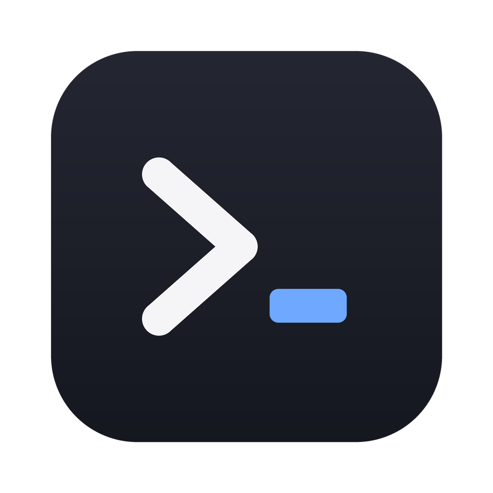
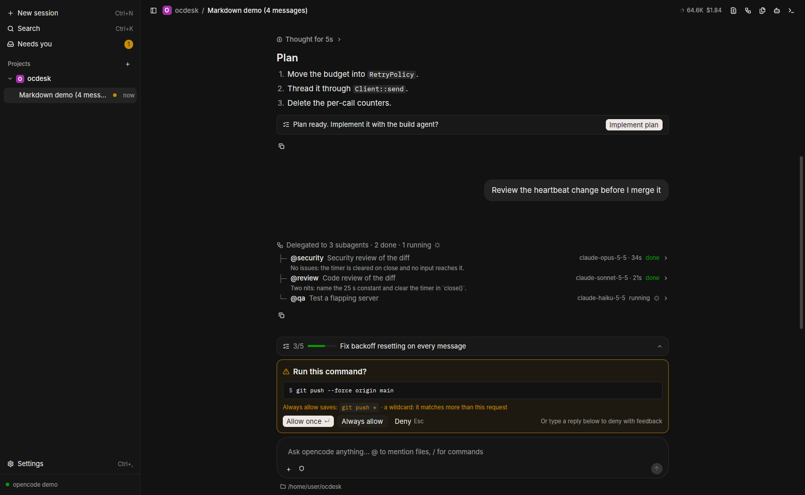
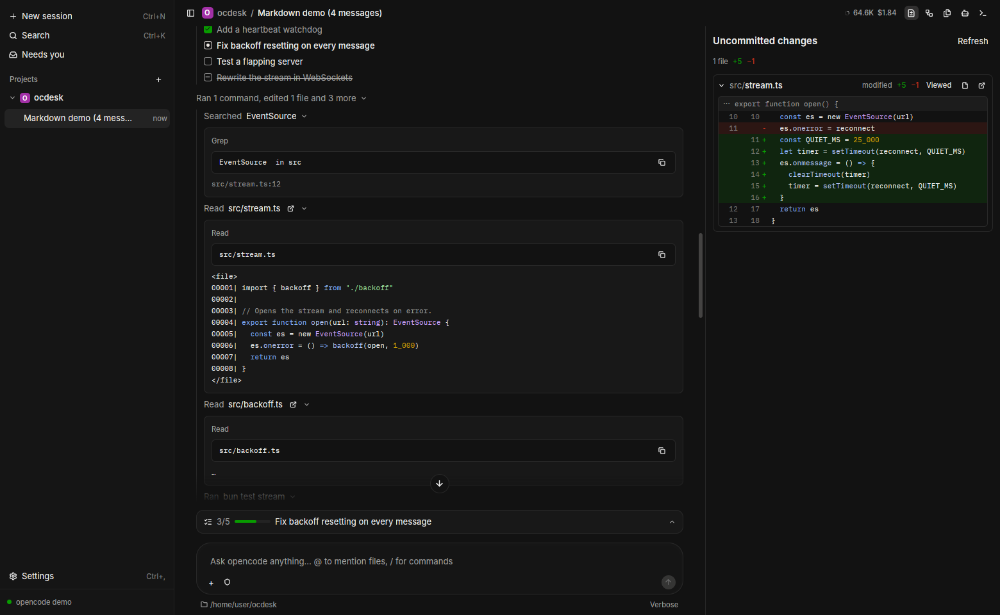
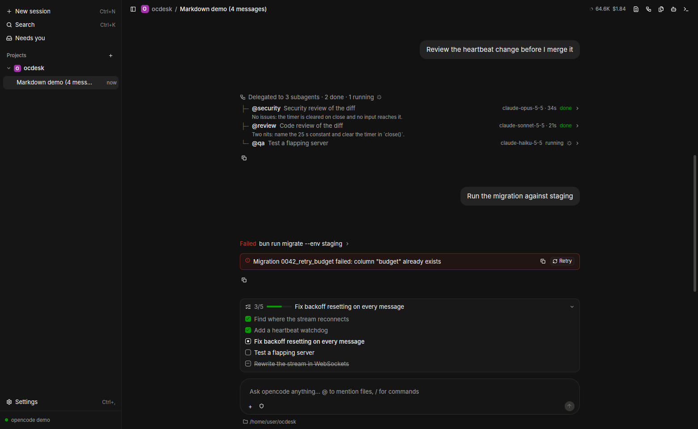
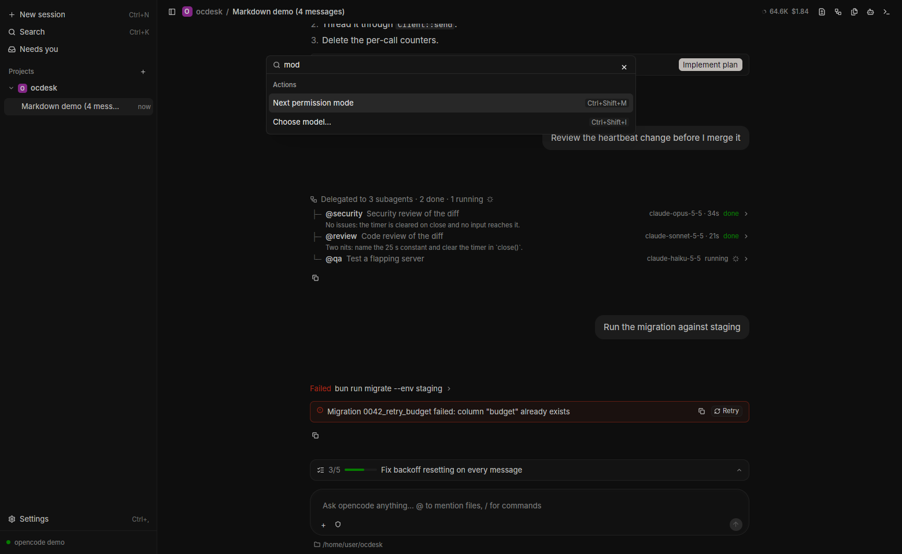

<div align="center">



# ocdesk

**A fast, native desktop app for the [opencode](https://opencode.ai) coding agent.**

Rust + [GPUI](https://www.gpui.rs) (the UI framework behind Zed). No Electron, no webview, no JavaScript.

[](https://github.com/bmz1/ocdesk/actions/workflows/ci.yml)
[](LICENSE)


[Install](#install) · [Features](#features) · [Shortcuts](#keyboard-shortcuts) · [How it works](#how-it-works) · [Contributing](CONTRIBUTING.md)

<br>



</div>

---

ocdesk is a **pure client**. It starts `opencode serve` as a child process and
talks to it over opencode's own HTTP API and event stream. Agents, tools,
providers, permissions and your config all stay in opencode, so ocdesk works
with whatever model and setup you already use, and it never changes how the
agent behaves.

## Why ocdesk

- **Native and fast.** GPU-rendered with GPUI and a virtualized transcript that
  built and profiled for 500+ message sessions.
- **Built for watching an agent work.** Tool calls fold into a readable work
  log, approvals sit right above the prompt, and the sessions that need you are
  one shortcut away.
- **Review before you trust.** Diffs for the latest turn, the working tree, the
  whole branch or any commit, with inline comments you send back to the agent
  in one prompt.
- **Keyboard-first.** A command palette and shortcuts for everything,
  including allowing and denying approvals.
- **Robust.** It reconnects and reconciles after network blips, restarts a
  crashed opencode automatically, and never leaves an orphaned server behind.

## Features

<table>
<tr>
<td width="50%" valign="top">

**Subagents and teams**<br>
Edit opencode agent files in the **Agents** panel, add a starter team
(architect → engineer → parallel security/review/QA), and watch parallel
delegations as a live tree.

</td>
<td width="50%" valign="top">

**Work log and diff review**<br>
Every read, search, command and edit as a foldable row with syntax-highlighted
output. The **Changes** panel shows each file's diff, and you can comment on any
line.

</td>
</tr>
<tr>
<td></td>
<td></td>
</tr>
<tr>
<td width="50%" valign="top">

**Plans and todos**<br>
Follow the agent's todo list in a progress pill, turn a finished plan into
code with **Implement plan**, and **Retry** failed steps.

</td>
<td width="50%" valign="top">

**Command palette**<br>
`Mod+K` reaches every session, folder, model and action, each listed with its
shortcut.

</td>
</tr>
<tr>
<td></td>
<td></td>
</tr>
</table>

**Plus:**

- **Folders and sessions**: sessions grouped by project with pin, archive (with
  undo), rename, unread markers and a **Needs you** inbox for approvals,
  questions and failures. One opencode server handles every folder.
- **Approvals**: allow once, always allow (it shows the exact rule that will be
  saved), or deny with typed feedback. Permission modes switch with one
  shortcut.
- **Composer**: `@` to mention files and subagents, `/` for commands and
  skills, image and file attachments, queue or steer while a turn runs, and
  pickers for agent, model and reasoning effort.
- **Editor tabs**: open files next to the chat, edit them, and save with a
  conflict check, so agent edits never silently overwrite yours.
- **Pull request panel** (with `gh`): CI checks with failed-step logs and review
  threads, each one click away from being sent to the agent.
- **Terminal**: the session's persistent shell, emulated with `alacritty_terminal`.
- **Transcript tools**: fork from any reply, undo from any prompt (also rolls
  back file changes), find in the conversation, and a context-usage ring with a
  one-click **Compact**.
- **Usage and cost**: tokens, cost and duration per turn and per session.
- **Native desktop**: notifications, light, dark and system themes, and restored
  window and session state. It also follows your OS reduced-motion setting.

Details and API caveats: [docs/desktop-features.md](docs/desktop-features.md).

## Install

### Requirements

ocdesk needs **opencode 2.x** with a configured provider:

```sh
npm i -g @opencode/cli@2.2.6     # installs `opencode` and `opencode2`
```

> [!NOTE]
> `opencode-ai` on npm and the `opencode.ai/install` script install the 1.x line,
> which ocdesk doesn't support. ocdesk looks for `opencode2`, then `opencode`;
> set `OCDESK_OPENCODE=/path/to/binary` to override.

### Download

Grab a build from [**Releases**](https://github.com/bmz1/ocdesk/releases):

| Platform | File | Notes |
|---|---|---|
| macOS 11+ (universal) | `ocdesk-<version>-macos-universal.dmg` | If the build is ad-hoc signed: right-click → **Open** on first launch, or `xattr -dr com.apple.quarantine /Applications/ocdesk.app` |
| Linux x86_64 / aarch64 | `ocdesk-<version>-linux-<arch>.AppImage` | `chmod +x` and run |
| Linux x86_64 / aarch64 | `ocdesk-<version>-linux-<arch>.tar.gz` | Unpack and run `./install.sh` (installs to `~/.local`, or set `PREFIX=/usr/local`) |

### Build from source

```sh
git clone https://github.com/bmz1/ocdesk && cd ocdesk
cargo run --release              # or: cargo run --release -- ~/code/my-project
```

`rustup` picks up the pinned toolchain automatically. On Linux, first install
the [build dependencies](docs/development.md#build-dependencies).

The icon is embedded for macOS Dock and X11 launches. For Linux source builds,
register the launcher and icon so Wayland and application menus can find them:

```sh
python3 dev/install-desktop.py target/release/ocdesk
```

Use `target/debug/ocdesk` for debug builds. Tarball `install.sh` already installs
the desktop entry and icons.

## Usage

Add a folder with **+** next to *Folders* (or `Mod+O`), or pass one on the
command line. Pick a model in the composer and start typing. On first run,
ocdesk adds the directory it was launched from.

When you start it from the Dock, Finder or a desktop launcher, ocdesk reads
`PATH` from your login shell, so opencode and its tools (git, rg, compilers)
are found the same way as in your terminal.

### Keyboard shortcuts

`Mod` is Cmd on macOS and Ctrl elsewhere. `Mod+/` shows the full list in the app.

| Keys | Action |
|---|---|
| `Mod+K` | Command palette |
| `Mod+N` / `Mod+O` | New session / add folder |
| `Mod+Shift+U` | Sessions that need you |
| `Enter` / `Esc` (empty prompt) | Allow once / deny a pending approval |
| `Mod+.` or `Esc Esc` | Stop the running turn |
| `Mod+F` | Find in the conversation |
| `Mod+P` | Go to file |
| `Mod+Shift+I` / `R` / `M` | Choose model / next reasoning effort / next permission mode |

<details>
<summary>All shortcuts</summary>

| Keys | Action |
|---|---|
| `Mod+B` | Show/hide sidebar |
| `Alt+↑` / `Alt+↓`, `Ctrl+Tab` / `Ctrl+Shift+Tab` | Previous / next session |
| `↑` / `↓`, `Enter`, `Delete`, `P` (sidebar focused) | Move, open, archive, pin |
| `F2` | Rename session |
| `F6` / `Shift+F6` | Cycle focus: sidebar → conversation → prompt → panel |
| `Mod+L` | Focus the prompt |
| typed text + `Enter` (pending approval) | Deny with feedback |
| `Ctrl+O` (macOS) / `Ctrl+Shift+O` | Transcript detail: normal → verbose → hide successful work |
| `Mod+Shift+D` / `T` / `A` / `G` / `E` | Right panel: Changes / Tasks / Agents / Pull request / Files |
| `` Ctrl+` `` | Right panel: Terminal |
| `Mod+S` / `Mod+W` | Save / close the editor tab |
| `Mod+1`, `Mod+Shift+]` / `Mod+Shift+[` | Chat tab, next / previous tab |
| `Mod+Shift+C` | Copy the last reply |
| `Mod+Shift+V` | Paste large text inline instead of as a file |
| `Mod+Q` | Quit |

</details>

### Configuration

Settings live in `~/.config/ocdesk/settings.json` (Linux) or
`~/Library/Application Support/ocdesk/settings.json` (macOS) and are edited
from **Settings** (`Mod+,`). Its **OpenCode** tab edits global and project
`opencode.json(c)` files directly; model, agent and permission defaults are
inherited from OpenCode. **Saved approvals** lists and revokes project grants.
**MCP servers** shows connections, connect/disconnect controls and setup instructions.
Logs go to `~/.local/share/ocdesk/logs/`
(Linux) or `~/Library/Application Support/ocdesk/logs/` (macOS).

| Variable | Effect |
|---|---|
| `OCDESK_OPENCODE` | Path to the opencode binary |
| `OCDESK_DIR` | Folder to open at startup |
| `OCDESK_THEME` | `dark` (default), `light` or `system` |
| `OCDESK_LOG` | Log filter (`EnvFilter` syntax, e.g. `debug`, `sse=debug`) |
| `OCDESK_NO_SHELL_ENV=1` | Don't read `PATH` from the login shell |
| `OCDESK_REDUCE_MOTION=1`/`0` | Force reduced motion on or off |
| `OCDESK_DEMO=<turns>` | Offline UI demo, with no opencode and no model |

## How it works

```
┌────────────── ocdesk (Rust / GPUI) ──────────────┐
│  views ──intents──▶ Controller ──▶ HTTP client ──┼──HTTP──▶  opencode serve
│    ▲                                             │          (child process, 127.0.0.1,
│    └──── Store ◀── normalized events ◀── SSE ◀───┼──SSE───   random per-launch password)
└──────────────────────────────────────────────────┘
```

- **One server for all folders.** Each session is pinned to its folder, and a
  single `GET /api/event` stream carries events for every folder.
- **The UI thread never blocks.** Networking runs on a dedicated Tokio runtime,
  views only call controller intents, and the store emits fine-grained events,
  so the virtualized list re-measures only the rows that changed.
- **Resilient.** A 30 s heartbeat watchdog, reconnects with exponential
  backoff, and a full reconcile on every reconnect. A crashed server is
  restarted automatically (up to 3 times a minute).
- **No orphans.** opencode runs in its own process group, which is killed on
  quit, panic and signals, plus `PR_SET_PDEATHSIG` on Linux.
- **Tested against the real thing.** Unit tests replay captured opencode
  events through the store, and CI runs protocol tests against a real
  opencode server with a deterministic mock model.

More: [docs/development.md](docs/development.md#architecture) ·
[docs/protocol-notes.md](docs/protocol-notes.md) ·
[docs/gpui-notes.md](docs/gpui-notes.md)

### Pinned versions

| What | Version | Why |
|---|---|---|
| opencode | **2.2.6** | ocdesk refuses 1.x and warns when the version differs |
| GPUI | `gpui-pre =0.3.11` (zed@f816e1f) via `gpui-kit =0.9.0` | GPUI's API changes between snapshots ([why gpui-kit](docs/gpui-notes.md)) |
| Rust | **1.99.1**, edition 2024 | Set in `rust-toolchain.toml` |

## Contributing

Contributions are welcome. See [CONTRIBUTING.md](CONTRIBUTING.md) for the
checks a PR needs and [docs/development.md](docs/development.md) for the
offline mock model, demo mode, test harnesses and architecture. You don't need
an API key to develop. To report a security issue, see [SECURITY.md](SECURITY.md).

## Known limitations

- macOS is the primary target and CI builds and tests it, but day-to-day use so
  far has been on Linux. macOS bug reports are especially welcome.
- `@` mentions attach files only, not directories.
- On macOS, `kill -9` of ocdesk can orphan the opencode server, because macOS
  has no `PDEATHSIG` equivalent. Every other way of exiting is covered.

## Acknowledgements

- [opencode](https://opencode.ai): the agent that does the actual work.
  The colour theme is generated from opencode's `@opencode/ui` tokens (MIT).
- [GPUI](https://github.com/zed-industries/zed) by Zed Industries and
  [gpui-component](https://github.com/longbridge/gpui-component).
- [alacritty_terminal](https://github.com/alacritty/alacritty), [syntect](https://github.com/trishume/syntect)
  and [two-face](https://github.com/CosmicHorrorDev/two-face).
- The bundled fonts [Inter](https://rsms.me/inter/), [IBM Plex Mono](https://github.com/IBM/plex) and
  [Symbols Nerd Font](https://www.nerdfonts.com/) are each under their own license
  in [`assets/fonts/`](assets/fonts).

ocdesk is an independent project. It is not affiliated with or endorsed by the
opencode project.

## License

[MIT](LICENSE) © 2026 Mate Boer
