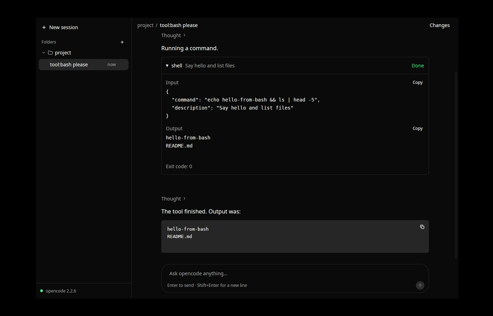
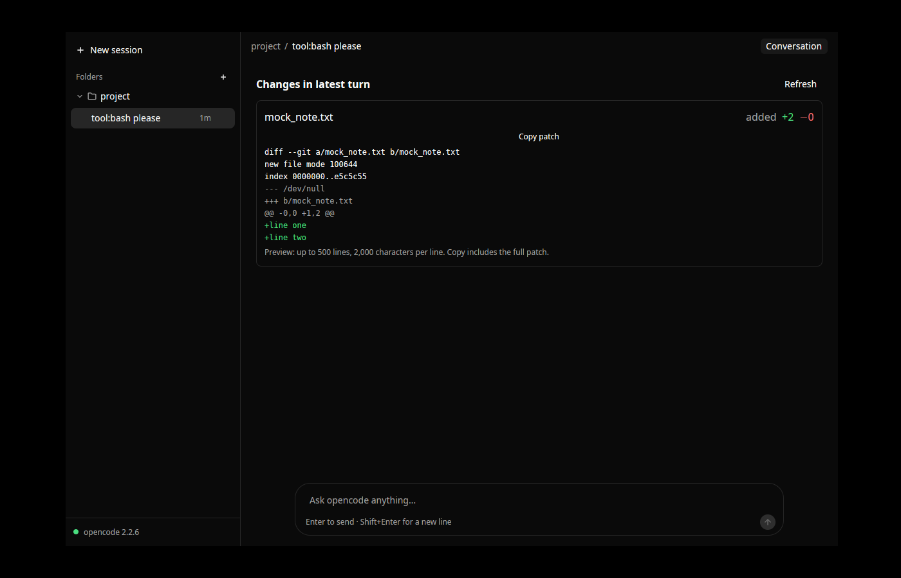

# ocdesk

A native desktop client for the [opencode](https://opencode.ai) coding agent,
written in Rust with [GPUI](https://github.com/zed-industries/zed/tree/main/crates/gpui).
No Electron, no webview, no JavaScript.

ocdesk is purely a client. It starts one `opencode serve` (opencode **2.x**)
as a child process and talks to it over its HTTP API (`/api/*`) and event
stream. All agent logic, tools, providers and permissions stay in opencode.

```
ocdesk (Rust/GPUI) ──HTTP──▶ opencode serve   (child process, 127.0.0.1, random password)
                   ◀──SSE───  GET /api/event   (one stream for every folder)
```

**Status:** M0–M7 plus attachments, permission modes, native notifications/unread,
Settings, branch/commit diff review and usage/context details. The queue/steer,
background-task and worktree controls are preserved. See
[desktop features](docs/desktop-features.md) for behavior and API limitations,
and [handoff.md](handoff.md) for current verification and next steps.






## Pinned versions

| What | Version | Why pinned |
|---|---|---|
| opencode | **2.2.6** (`@opencode/cli`) | ocdesk refuses anything below 2.x and warns if the version differs from the pin |
| gpui | `gpui-pre =0.3.11` = **zed@f816e1f** (via `gpui-kit =0.9.0`) | GPUI's API changes between snapshots |
| gpui-component | 0.9.0 (via `gpui-kit`) | must match the gpui snapshot |
| Rust | **1.99.1** (edition 2024, `rust-toolchain.toml`) | gpui-pre-macos needs `Option::map_or_default` (stable in 1.99); Linux would build on older |

Why `gpui-kit` and not a Zed git rev: see [docs/gpui-notes.md](docs/gpui-notes.md).
The API ocdesk relies on, with real samples: [docs/protocol-notes.md](docs/protocol-notes.md).

## Installing

Builds come from the **Package** workflow (tag `vX.Y.Z` → draft GitHub
release; or *Run workflow* for artifacts only):

- **macOS** (11+, universal): `ocdesk-<version>-macos-universal.dmg` (or `.zip`).
  Builds are ad-hoc signed unless the signing secrets below are configured, so
  on first launch right-click → **Open**, or run
  `xattr -dr com.apple.quarantine /Applications/ocdesk.app`.
- **Linux** (x86_64, aarch64): `ocdesk-<version>-linux-<arch>.AppImage`
  (`chmod +x` and run), or the `.tar.gz`: unpack and run `./install.sh`
  (installs to `~/.local`, or `PREFIX=/usr/local`), which adds a desktop entry
  and icon.

Started from the Dock, Finder or a desktop launcher, an app doesn't get your
shell's `PATH`, so ocdesk asks your login shell for it at startup (`$SHELL -l -i`,
5 s timeout). That's how it finds `opencode2` installed through npm/nvm/Volta/
Homebrew, and what opencode's tools (git, rg, compilers) see. From a terminal
the inherited `PATH` is used as is. `OCDESK_NO_SHELL_ENV=1` turns this off.

## Running

Requirements: **opencode 2.x** and a configured provider:

```sh
npm i -g @opencode/cli@2.2.6     # installs `opencode` and `opencode2`
```

(`opencode-ai` on npm and the `opencode.ai/install` script are the 1.x line;
ocdesk doesn't support 1.x. ocdesk looks for `opencode2`, then `opencode`;
`OCDESK_OPENCODE=/path/to/binary` overrides.)

```sh
cargo run --release              # or: cargo run --release -- ~/code/my-project
```

**Folders.** Sessions are grouped by folder, like projects in Codex. Add one
with **+** next to *Folders* (native folder picker; on Linux without an
xdg-desktop-portal it asks for a path instead), or start ocdesk with a folder
argument or `OCDESK_DIR`. On first run the launch directory is added. One
opencode sidecar serves all folders: each session is pinned to its
folder. Folders, collapsed state, theme, window size/position (and whether it
was maximized), sidebar width and visibility, the last open session and the
model/agent picked for new sessions are saved in
`~/.config/ocdesk/settings.json` (Linux) or
`~/Library/Application Support/ocdesk/settings.json` (macOS). The last open
session is reopened on start unless a folder is passed on the command line.
Drag the sidebar's right edge to resize it (double-click resets it).

**Files and editor tabs.** Files open in tabs next to the chat
(`[Chat] [main.rs ●]`), from the **Files** panel, `Mod+P`, a read/edit tool
row (↗) or the Changes panel. Tabs belong to the folder and are reopened on
start. Saving is explicit (`Mod+S`): before writing, ocdesk checks that the
file on disk is still the version the tab was based on. When the agent (or
anything else) changes an open file, a tab without unsaved edits reloads; a
tab with unsaved edits is never overwritten and offers *Reload* or *Keep
mine*. Binary files aren't shown; files over 2 MB open read-only. See
[docs/file-editor-plan.md](docs/file-editor-plan.md).

**Keyboard.** `Mod` is Cmd on macOS and Ctrl elsewhere; `Mod+/` shows the list.

| Keys | Action |
|---|---|
| `Mod+K` | Command palette: sessions, folders, actions, models, view |
| `Mod+F` | Find in the conversation (Enter / Shift+Enter step) |
| `Mod+N` | New session |
| `Mod+O` | Add folder… |
| `Mod+B` | Show/hide sidebar |
| `Mod+Shift+U` | Sessions that need you (approvals, questions, failures, news) |
| `Alt+↑` / `Alt+↓`, `Ctrl+Tab` / `Ctrl+Shift+Tab` | Previous / next session |
| `↑` / `↓`, `Enter`, `Delete`, `P` (sidebar focused) | Move, open, archive, pin |
| `F2` | Rename session |
| `F6` / `Shift+F6` | Focus sidebar → conversation → prompt → panel |
| `Mod+L` | Focus the prompt |
| `Mod+.` or `Esc Esc` in the prompt | Stop the running turn |
| `Enter` / `Esc` with an empty prompt | Allow once / deny a pending approval (typed text + Enter denies with feedback) |
| `Ctrl+O` (macOS) / `Ctrl+Shift+O` | Transcript detail: normal → verbose → hide successful work |
| `Mod+Shift+I` / `Mod+Shift+R` / `Mod+Shift+M` | Choose model / next reasoning effort / next permission mode |
| `Mod+Shift+D` / `Mod+Shift+T` / `Mod+Shift+A` / `Mod+Shift+B` / `` Ctrl+` `` | Right panel: Changes / Tasks / Agents / Browser / Terminal |
| `Mod+Shift+E` | Right panel: Files (folder tree; click a file to open it in a tab) |
| `Mod+P` | Go to file (opens it in an editor tab) |
| `Mod+S` / `Mod+W` | Save / close the editor tab |
| `Mod+1`, `Mod+Shift+]` / `Mod+Shift+[` | Chat tab, next / previous tab |
| `Mod+Shift+C` | Copy the last reply |
| `Mod+Shift+V` | Paste large text inline instead of as a file |
| `Mod+/` | Keyboard shortcuts |
| `Mod+Q` | Quit |

**Transcript.** Tool calls fold into one work-log row ("Ran 2 commands,
edited 3 files and 2 more"); while a call runs the row names it. Reasoning
shows as "Thought for 4s". Under a turn's last reply: Copy, and on hover
its duration, model, tokens, cost and **Fork from here**. Hovering a prompt
offers **Undo from here** (removes it, its replies and their file changes).
Failed steps get **Retry**; a finished plan-agent turn offers **Implement
plan**. The header shows context use (ring), tokens and cost; at 80 % a
**Compact** button appears.

**Todos and images.** When the agent keeps a todo list (`todowrite`), a
pill above the prompt shows progress and the current step; click it for the
checklist. Each update appears in the work log as "Updated todos · 3/5
done". Image attachments show as thumbnails in the prompt box and in the
transcript; click one to see it full size.

**Right panel.** **Changes** reviews the latest turn, working tree, branch or
commits file by file; hover a line and press `+` to comment, then **Send to
agent** turns the comments into one prompt. **Tasks** lists subagents and
background shells. **Browser** shows the browser an agent drives with [agent-browser](https://agent-browser.dev), live, and can take control; see [desktop features](docs/desktop-features.md#browser-agent-browser). **Agents** edits opencode's agent files (description,
mode, model, prompt) and adds a starter team; see
[desktop features](docs/desktop-features.md#agents-and-subagents).
**Terminal** opens the session's shell (opencode's
persistent PTY), which survives switching sessions and restarts.

**Errors.** If opencode is missing, too old or crashes, the sidebar footer
shows why, with **Restart opencode** and **Copy details** (the error plus
opencode's last output lines); a banner above the composer explains why
prompts are paused. A conversation whose history can't be loaded shows the
error with a **Retry** button.

**Theme.** opencode's own colours (generated from `@opencode/ui`'s tokens,
see `dev/gen-opencode-theme.py`) with Inter and IBM Plex Mono bundled
(SIL OFL, `assets/fonts/`). Dark by default; set `"theme": "light"` or
`"system"` in `settings.json` or the command palette, or
`OCDESK_THEME=light|system`.

Logs go to the platform data dir, e.g. `~/.local/share/ocdesk/logs/ocdesk.log`
(Linux) or `~/Library/Application Support/ocdesk/logs/ocdesk.log` (macOS).
Set `OCDESK_LOG` (an `EnvFilter` string) to change verbosity; every SSE frame
is logged at `debug` under the `sse` target.

Linux build dependencies (Debian/Ubuntu):

```sh
sudo apt install libxkbcommon-dev libxkbcommon-x11-dev libwayland-dev libvulkan-dev \
  libx11-xcb-dev libxcb-xkb-dev libfontconfig-dev libssl-dev libasound2-dev libzstd-dev
```

## Developing

`dev/mock_llm.py` is a deterministic OpenAI-compatible streaming model, so
everything can be exercised offline and without API keys. It streams
reasoning, markdown, `bash` tool calls and `write` tool calls.

opencode reads providers from its config dir, so point `XDG_CONFIG_HOME` at
`dev/xdg`, which wires the mock in as provider `mock` (and makes it the
default model). This also keeps ocdesk's own dev settings in
`dev/xdg/ocdesk/` (git-ignored).

```sh
python3 dev/mock_llm.py &                       # listens on 127.0.0.1:4555
XDG_CONFIG_HOME=$PWD/dev/xdg cargo run -- /path/to/some/repo
```

Prompt keywords: `tool:bash` (calls the `shell` tool), `tool:edit`, `long`, `rich`;
anything else gets a short reply. To exercise permission prompts, add
`"permission": {"shell": "ask", "edit": "ask"}` to `dev/xdg/opencode/opencode.json`.

**Tools and permissions.** Click a tool card to expand its complete input and
output. Copy keeps the full text even when a large preview is shortened.
Pending permission requests appear above the composer, with a waiting badge in
the sidebar. Choose **Allow once**, **Always allow** (when the server supplies
save rules), or **Reject**. The exact rules being saved are shown beside the
actions. Failed replies stay visible and retryable. Reconnecting and selecting a
session re-fetch pending requests; ocdesk never replies automatically.

**Composer.** Type `@` to search the folder's files (and subagents such as
`@general`); ↑/↓ and Enter or Tab pick one, Esc closes the list. A picked file
becomes a chip and is attached to the prompt (opencode inlines its content).
The footer picks the **agent** (Build, Plan, …), the **model** (grouped by
provider) and, when the model has them, its **variant** (reasoning effort).
With nothing selected, the pick applies to the next new session and sticks.
↑ in an empty prompt recalls earlier prompts of the session; ↓ goes back.

**Changes.** The conversation header's **Changes** button shows the latest
turn's files, addition/deletion counts, and colored unified patches. Use
**Refresh** during an active turn; opened diffs refresh when a turn finishes.
**Conversation** returns to the message list.

**Offline UI demo (no opencode, no model).** `OCDESK_DEMO=<turns>` skips the
sidecar and seeds one session with synthetic history (`turns` × user +
assistant, default 20); prompts get a streamed markdown reply through the
same `Store::apply` path real events take. `OCDESK_DEMO=250` is the
500-message perf case. `OCDESK_DEMO_DELAY_MS` sets the per-word delay
(default 15), `OCDESK_DEMO_AUTOPLAY=<prompt>` sends one prompt at startup
(`long` in it gives the long answer).

```sh
OCDESK_DEMO=250 OCDESK_DEMO_AUTOPLAY="long answer" OCDESK_FRAME_LOG=1 cargo run
```

**Frame times.** `OCDESK_FRAME_LOG=1` logs, once a second while frames are
drawn, the CPU time per frame (root `render` to last `paint`: count, mean,
p95, max) and peak RSS under the `ocdesk::frames` target. Debug builds also
log it at `debug`.

Verification hooks (env vars):

- `OCDESK_PROBE_PROMPT=<text>`: send `<text>` in a new session once connected.
- `OCDESK_EXIT_ON_IDLE=1`: quit (via the normal quit path) when a turn ends.
- `OCDESK_VERIFY_ON_IDLE=1` (debug builds): when a turn ends, compare the streamed
  store against `GET /api/session/{id}/message` and log `verify: store matches REST` or `MISMATCH`.
- `OCDESK_DEBUG_PANIC=1` (debug builds): panic on connect, to test sidecar teardown.
- `OCDESK_FOLDER_DIALOG=1`: skip the native folder picker and ask for a path.

Unit tests (`cargo test`) replay real captured opencode 2.2.6 events
(`tests/fixtures/`) through the store and check the result equals the
server's REST projection; they also cover reconcile, the execution
lifecycle, folder targeting, version parsing and SSE framing.

`python3 dev/m3-protocol-test.py /path/to/opencode2` checks live permission
requests, restoring pending requests, once/always/reject replies, rejected tool
history and latest-turn edit diffs against real opencode 2.2.6. It creates a
temporary repository and isolated config/data, and starts its own mock model.

`dev/teardown-test.sh` (Linux, Xvfb) checks that the sidecar dies on SIGTERM,
SIGINT, SIGKILL, panic and normal quit.

Before every commit: `cargo fmt && cargo clippy --all-targets -- -D warnings`.

**CI** (`.github/workflows/ci.yml`, every push to `master` and every PR):
Linux runs fmt, clippy, unit tests, shellcheck, then installs opencode 2.2.6
and runs `dev/m3-protocol-test.py` and `dev/teardown-test.sh` under Xvfb;
macOS runs clippy, unit tests and a build.

**Packaging** (`packaging/`, also what `.github/workflows/package.yml` runs):

```sh
packaging/linux/package.sh                    # AppImage + tarball in target/package/
SKIP_APPIMAGE=1 packaging/linux/package.sh    # tarball only
ARCHS="arm64 x86_64" packaging/macos/bundle.sh  # ocdesk.app, .dmg, .zip (on a Mac)
```

The AppImage is made with linuxdeploy (downloaded into `target/tools`).
macOS signing: set `MACOS_SIGN_IDENTITY` (a Developer ID Application identity)
and optionally `NOTARY_PROFILE` (from `xcrun notarytool store-credentials`).
In CI, add the repository secrets `MACOS_CERT_P12` (base64 .p12),
`MACOS_CERT_PASSWORD`, and for notarization `APPLE_ID`, `APPLE_TEAM_ID`,
`APPLE_APP_PASSWORD`; without them builds are ad-hoc signed. The app id is
`io.github.bmz1.ocdesk` (bundle id, Linux window class, desktop file).

## Architecture

```
src/
  main.rs            bootstrap: logging, tokio runtime thread, signals, window
  shell_env.rs       login-shell PATH for apps started outside a terminal
  sidecar.rs         spawn / health-check / kill `opencode serve`
  settings.rs        folders, theme, window/sidebar, last session, draft model/agent (JSON)
  api/mod.rs         thin HTTP client + SSE reader (the only place that does HTTP)
  api/model.rs       our view of sessions/messages/blocks (lenient JSON parsing)
  api/events.rs      server events → our normalized Event enum
  api/pty.rs         session terminals: persistent PTYs over a WebSocket
  store.rs           Entity<Store>: folders, sessions, conversations, busy; folds events
  controller.rs      intents → API calls; folders, sidecar lifecycle, auto-restart, SSE pump
  ui/app_view.rs     root layout: sidebar | conversation; theme; window/sidebar persistence
  ui/keys.rs         app-wide shortcuts, menu bar and the shortcuts sheet
  ui/kit.rs          shared components (status slot, monogram, context ring, toast…)
  ui/theme.rs        opencode theme + bundled fonts
  ui/palette.rs      command palette (Mod+K)
  ui/sidebar.rs      folders and sessions: status, pin, archive/undo, sections, Needs you
  ui/conversation.rs header, virtualized message list, find bar, right panel, status strip
  ui/message.rs      one message: prose, reasoning rows, turn footer, plan bar
  ui/tool_card.rs    work-log rows and tool cards, density
  ui/permission.rs   approvals above the prompt (keyboard: Enter / Esc / typed reply)
  ui/changes.rs      patch parsing and the diff view
  ui/review.rs       Changes tab: scopes, files, inline review comments
  ui/terminal.rs     Terminal tab (alacritty_terminal emulator)
  ui/syntax.rs       syntax colours for diffs, file reads and written files
  ui/todos.rs        todo list from todowrite: progress pill and checklists
  ui/images.rs       image thumbnails and the full-size viewer
  ui/composer.rs     prompt box, Send ↔ Stop, agent/model/variant pickers, @ popup, history
  ui/mention.rs      @ query detection, tokens → prompt attachments, history (pure)
  ui/form_view.rs    question forms (form.*) above the composer
docs/
  protocol-notes.md              endpoints + real event samples (opencode 2.2.6)
  openapi-opencode-2.2.6.json    the server's own spec (GET /openapi.json)
  gpui-notes.md                  GPUI patterns and surprises
tests/fixtures/                  real 2.2.6 captures used by the unit tests
packaging/                       icon, macOS bundle script + Info.plist, Linux AppImage/tarball
.github/workflows/               ci.yml (checks + e2e), package.yml (installers, draft release)
handoff.md                       state of the project for the next session
```

- **Threads:** GPUI owns the main thread. A dedicated multi-threaded Tokio
  runtime (`ocdesk-net-*` threads) runs reqwest and SSE. Results return over
  `futures` channels, awaited in `cx.spawn` tasks that update entities and
  call `cx.notify()`. The UI thread never blocks on I/O.
- **Sidecar lifecycle:** `opencode serve --port 0` in its own process group,
  with a random 32-character `OPENCODE_SERVER_PASSWORD` per launch (HTTP
  Basic, user `opencode`). The bound URL is parsed from stdout, then
  `/api/info` is polled. The whole process group is killed from
  `on_app_quit`, the panic hook, the SIGINT/SIGTERM handler and a drop guard.
  On Linux `PR_SET_PDEATHSIG` also covers `kill -9`. The last 200 stderr
  lines are kept for crash reports.
- **One sidecar for all folders:** sessions are created with
  `location.directory` and stay pinned to it; `GET /api/event` carries events
  for every location. A thin reqwest client (no SDK crate: the Rust
  `opencode-codes` crate targets the 1.x API).
- **Events:** our SSE reader emits explicit `Connected` / `Disconnected`,
  treats 30 s without a frame as a dead connection (the server heartbeats
  every 10-15 s) and reconnects with exponential backoff (250 ms → 5 s).
- **Busy state:** from `session.execution.started` /
  `succeeded|failed|interrupted`, re-seeded from `GET /api/session/active`
  after every reconnect.
- **State:** views never call HTTP. They call `Controller` intents
  (`send_prompt`, `abort`, `add_folder`, `rename_session`, …), which run on
  Tokio and fold results into `Store`. `Store` emits fine-grained events
  (`MessageInserted`, `MessageChanged`, …) so the virtualized list re-measures
  only the row that changed.
- **Reconcile:** on every (re)connect the session list, busy set and the
  selected conversation are re-fetched and merged into the store: the snapshot
  wins, except where locally streamed text strictly extends it (the server
  persists text slightly after streaming it) and except for messages newer
  than the snapshot. Other conversations are re-fetched when next selected.
- **Crash recovery:** if the sidecar dies it is restarted automatically
  (up to 3 times a minute), then the UI reconnects and reconciles. A Restart
  button covers the rest.

## Roadmap

- [x] **M0** Spike: pinned stack, window, sidecar lifecycle, prompt round-trip, protocol notes
- [x] **M1** Folders + sessions sidebar, plain-text streaming conversation, composer, reconnect + reconcile, opencode 2.x, dark theme
- [x] **M2** Incremental streaming markdown, code copy buttons, links, selectable text, collapsible reasoning, frame-time probe
- [x] **M3** Tool cards, permissions (`permission.asked`), diffs
- [x] **M4** Question forms, @mentions (files, subagents), model/variant/agent picker, prompt history
- [x] **M5** Keyboard, persistence of window/sidebar, error states
- [x] **M6** Packaging (.app, AppImage), CI
- [x] **M7** Queue/steer, slash commands/skills, background tasks, branches/worktrees
- [x] **Desktop feature batch** Attachments, permission modes, notifications/unread, Settings, full diff review, usage/context (items 4–8 and 10; Git write actions excluded)

## Design

The UI follows the Codex app's layout ideas: a quiet sidebar of folders with
their sessions, one centered conversation column (max 760 px), user messages
as soft right-aligned bubbles, assistant output as plain flowing text, tool
calls as expandable cards, and a rounded composer docked at the bottom (centered
on the start screen, with a folder chooser). Dark theme by default; colors
come from gpui-component's neutral theme.

## Known limitations

- Only run on Linux (Xvfb + llvmpipe) so far. macOS is the primary target;
  it type-checks and lints for `aarch64-apple-darwin`, and CI builds and tests
  it, but nobody has opened the window on a Mac yet.
- `@` mentions attach files only; directories from the file search are
  hidden. Recalled history entries come back as plain text (their mention
  tokens aren't restored).
- Changes shows the latest turn, not a full session or repository diff. Patch
  previews are bounded; Copy patch includes the full patch returned by opencode.
- On macOS a `kill -9` of ocdesk can orphan the sidecar: there is no
  `PDEATHSIG` equivalent. Every other exit path is covered.

