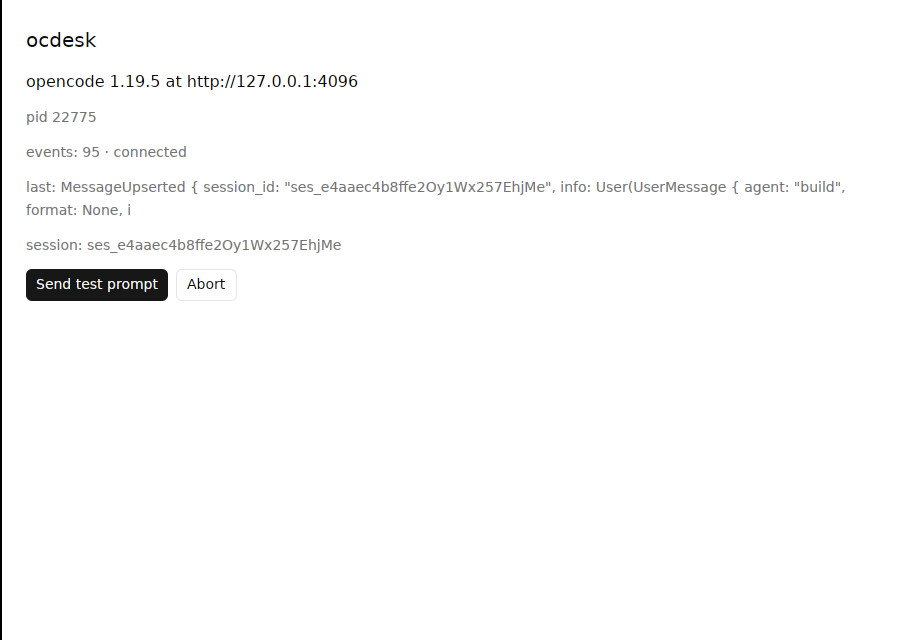

# ocdesk

A native desktop client for the [opencode](https://opencode.ai) coding agent,
written in Rust with [GPUI](https://github.com/zed-industries/zed/tree/main/crates/gpui).
No Electron, no webview, no JavaScript.

ocdesk is purely a client. It starts `opencode serve` as a child process and
talks to it over HTTP + SSE. All agent logic, tools, providers and permissions
stay in opencode.

```
ocdesk (Rust/GPUI) ──HTTP──▶ opencode serve   (child process, 127.0.0.1, random password)
                   ◀──SSE───  GET /event
```

**Status:** milestone M0 (spike). The window shows the sidecar's status and
can send a test prompt; the full round-trip is logged. See *Roadmap*.



## Pinned versions

| What | Version | Why pinned |
|---|---|---|
| opencode | **1.19.5** | ocdesk warns at startup if `opencode --version` differs |
| gpui | `gpui-pre =0.3.11` = **zed@f816e1f** (via `gpui-kit =0.9.0`) | GPUI's API changes between snapshots |
| gpui-component | 0.9.0 (via `gpui-kit`) | must match the gpui snapshot |
| opencode-codes | =1.19.5 | typed client generated from the 1.19.5 OpenAPI spec |
| Rust | 1.97 (edition 2024) | |

Why `gpui-kit` and not a Zed git rev: see [docs/gpui-notes.md](docs/gpui-notes.md).

## Running

Requirements: opencode on `PATH` (`npm i -g opencode-ai@1.19.5` or
`curl -fsSL https://opencode.ai/install | bash`) and a configured provider.

```sh
cargo run --release
```

ocdesk runs opencode in its current directory, or in `$OCDESK_DIR` if set.
Logs go to the platform data dir, e.g. `~/.local/share/ocdesk/logs/ocdesk.log`
(Linux) or `~/Library/Application Support/ocdesk/logs/ocdesk.log` (macOS).
Set `OCDESK_LOG` (an `EnvFilter` string) to change verbosity; every SSE frame
is logged at `debug` under the `sse` target.

Linux build dependencies (Debian/Ubuntu):

```sh
sudo apt install libxkbcommon-dev libxkbcommon-x11-dev libwayland-dev libvulkan-dev \
  libx11-xcb-dev libxcb-xkb-dev libfontconfig-dev libssl-dev libasound2-dev libzstd-dev
```

## Developing

`dev/mock_llm.py` is a deterministic OpenAI-compatible streaming model, so
everything can be exercised offline and without API keys. It can stream
reasoning, markdown, `bash` tool calls and `write` tool calls.
`dev/mock-opencode.json` wires it in as provider `mock` and sets bash/edit
permissions to `ask`:

```sh
python3 dev/mock_llm.py &                       # listens on 127.0.0.1:4555
export OPENCODE_CONFIG_CONTENT="$(cat dev/mock-opencode.json)"
OCDESK_PROBE_PROMPT="tool:bash please" cargo run
```

Prompt keywords: `tool:bash`, `tool:edit`, `long`; anything else gets a short reply.

Verification hooks (env vars):

- `OCDESK_PROBE_PROMPT=<text>`: create a session and send `<text>` once the event stream connects.
- `OCDESK_EXIT_ON_IDLE=1`: when that session goes idle, log the REST message list and quit.
- `OCDESK_DEBUG_PANIC=1` (debug builds only): panic on connect, to test sidecar teardown.

`dev/teardown-test.sh` (Linux, Xvfb) checks that the sidecar dies on SIGTERM,
SIGINT, SIGKILL, panic and normal quit.

Before every commit: `cargo fmt && cargo clippy --all-targets -- -D warnings`.

## Architecture

```
src/
  main.rs          bootstrap: logging, tokio runtime thread, signals, window
  sidecar.rs       spawn / health-check / kill `opencode serve`
  api/mod.rs       wrapper over opencode-codes (only place that does HTTP)
  api/events.rs    our normalized Event enum (SSE → app)
  ui/app_view.rs   root view
docs/
  protocol-notes.md              endpoints + real event samples
  openapi-opencode-1.19.5.json   the server's own spec (GET /doc)
  gpui-notes.md                  GPUI patterns and surprises
```

- **Threads:** GPUI owns the main thread. A dedicated multi-threaded Tokio
  runtime (`ocdesk-net-*` threads) runs reqwest and SSE. Results return over
  `futures` channels, awaited in `cx.spawn` tasks that update entities and
  call `cx.notify()`. The UI thread never blocks on I/O.
- **Sidecar lifecycle:** `opencode serve --port 0 --print-logs` in its own
  process group, with a random 32-character `OPENCODE_SERVER_PASSWORD` per
  launch (HTTP Basic, user `opencode`). The bound URL is parsed from stdout,
  then `/global/health` is polled. The whole process group is killed from
  `on_app_quit`, the panic hook, the SIGINT/SIGTERM handler and a drop guard.
  On Linux `PR_SET_PDEATHSIG` also covers `kill -9`. The last 200 stderr
  lines are kept for crash reports.
- **Events:** `opencode-codes`' `EventStream` reconnects with backoff and
  yields `Connected` on every (re)open, which is our cue to reconcile over
  REST (M1).

## Roadmap

- [x] **M0** Spike: pinned stack, window, sidecar lifecycle, prompt round-trip, protocol notes
- [ ] **M1** Sessions sidebar, plain-text streaming conversation, composer, reconnect + reconcile
- [ ] **M2** Virtualized list, incremental streaming markdown
- [ ] **M3** Tool cards, permissions, diffs
- [ ] **M4** @mentions, model/agent picker, history
- [ ] **M5** Projects, keyboard, theme, persistence, error states
- [ ] **M6** Packaging (.app, AppImage), CI

## Known limitations

- Only verified on Linux (Xvfb + llvmpipe) so far. macOS is the primary
  target but hasn't been run yet.
- On macOS a `kill -9` of ocdesk can orphan the sidecar: there is no
  `PDEATHSIG` equivalent. Every other exit path is covered.
