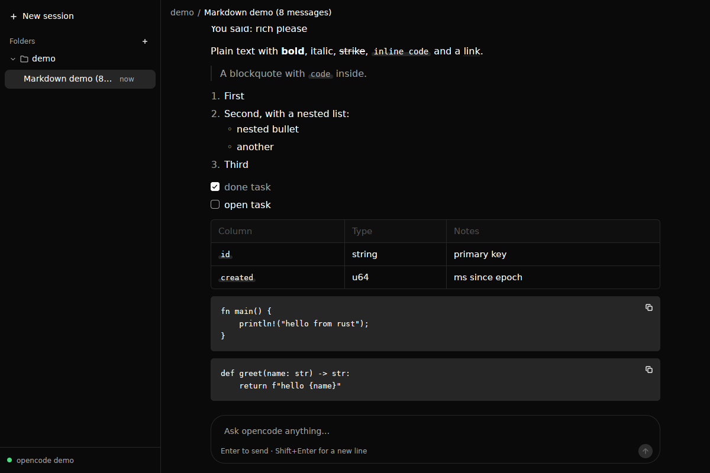

# ocdesk

A native desktop client for the [opencode](https://opencode.ai) coding agent,
written in Rust with [GPUI](https://github.com/zed-industries/zed/tree/main/crates/gpui).
No Electron, no webview, no JavaScript.

ocdesk is purely a client. It starts one `opencode serve` (opencode **2.x**)
as a child process and talks to it over its HTTP API (`/api/*`) and event
stream. All agent logic, tools, providers and permissions stay in opencode.

```
ocdesk (Rust/GPUI) ──HTTP──▶ opencode serve   (child process, 127.0.0.1, random password)
                   ◀──SSE───  GET /api/event   (one stream for every folder)
```

**Status:** milestone M2: folders with their sessions, live streaming
conversation rendered as incrementally parsed markdown (code blocks with
copy buttons, tables, links that open in the browser, selectable text),
collapsible reasoning, composer with send/stop, rename/delete, reconnect and
sidecar crash recovery, dark theme by default. Tool cards and permissions
come in M3. See *Roadmap* and [handoff.md](handoff.md).



## Pinned versions

| What | Version | Why pinned |
|---|---|---|
| opencode | **2.2.6** (`@opencode/cli`) | ocdesk refuses anything below 2.x and warns if the version differs from the pin |
| gpui | `gpui-pre =0.3.11` = **zed@f816e1f** (via `gpui-kit =0.9.0`) | GPUI's API changes between snapshots |
| gpui-component | 0.9.0 (via `gpui-kit`) | must match the gpui snapshot |
| Rust | 1.97 (edition 2024) | |

Why `gpui-kit` and not a Zed git rev: see [docs/gpui-notes.md](docs/gpui-notes.md).
The API ocdesk relies on, with real samples: [docs/protocol-notes.md](docs/protocol-notes.md).

## Running

Requirements: **opencode 2.x** and a configured provider:

```sh
npm i -g @opencode/cli@2.2.6     # installs `opencode` and `opencode2`
```

(`opencode-ai` on npm and the `opencode.ai/install` script are the 1.x line;
ocdesk doesn't support 1.x. ocdesk looks for `opencode2`, then `opencode`;
`OCDESK_OPENCODE=/path/to/binary` overrides.)

```sh
cargo run --release              # or: cargo run --release -- ~/code/my-project
```

**Folders.** Sessions are grouped by folder, like projects in Codex. Add one
with **+** next to *Folders* (native folder picker; on Linux without an
xdg-desktop-portal it asks for a path instead), or start ocdesk with a folder
argument or `OCDESK_DIR`. On first run the launch directory is added. One
opencode sidecar serves all folders: each session is pinned to its
folder. Folders, collapsed state and theme are saved in
`~/.config/ocdesk/settings.json` (Linux) or
`~/Library/Application Support/ocdesk/settings.json` (macOS).

**Theme.** Dark by default. Set `"theme": "light"` or `"system"` in
`settings.json`, or `OCDESK_THEME=light|system`.

Logs go to the platform data dir, e.g. `~/.local/share/ocdesk/logs/ocdesk.log`
(Linux) or `~/Library/Application Support/ocdesk/logs/ocdesk.log` (macOS).
Set `OCDESK_LOG` (an `EnvFilter` string) to change verbosity; every SSE frame
is logged at `debug` under the `sse` target.

Linux build dependencies (Debian/Ubuntu):

```sh
sudo apt install libxkbcommon-dev libxkbcommon-x11-dev libwayland-dev libvulkan-dev \
  libx11-xcb-dev libxcb-xkb-dev libfontconfig-dev libssl-dev libasound2-dev libzstd-dev
```

## Developing

`dev/mock_llm.py` is a deterministic OpenAI-compatible streaming model, so
everything can be exercised offline and without API keys. It streams
reasoning, markdown, `bash` tool calls and `write` tool calls.

opencode reads providers from its config dir, so point `XDG_CONFIG_HOME` at
`dev/xdg`, which wires the mock in as provider `mock` (and makes it the
default model). This also keeps ocdesk's own dev settings in
`dev/xdg/ocdesk/` (git-ignored).

```sh
python3 dev/mock_llm.py &                       # listens on 127.0.0.1:4555
XDG_CONFIG_HOME=$PWD/dev/xdg cargo run -- /path/to/some/repo
```

Prompt keywords: `tool:bash` (calls the `shell` tool), `tool:edit`, `long`,
`rich` (every markdown construct, longer reasoning);
anything else gets a short reply. For permission work (M3) add
`"permission": {"shell": "ask", "edit": "ask"}` to `dev/xdg/opencode/opencode.json`.

**Offline UI demo (no opencode, no model).** `OCDESK_DEMO=<turns>` skips the
sidecar and seeds one session with synthetic history (`turns` × user +
assistant, default 20); prompts get a streamed markdown reply through the
same `Store::apply` path real events take. `OCDESK_DEMO=250` is the
500-message perf case. `OCDESK_DEMO_DELAY_MS` sets the per-word delay
(default 15), `OCDESK_DEMO_AUTOPLAY=<prompt>` sends one prompt at startup
(`long` in it gives the long answer).

```sh
OCDESK_DEMO=250 OCDESK_DEMO_AUTOPLAY="long answer" OCDESK_FRAME_LOG=1 cargo run
```

**Frame times.** `OCDESK_FRAME_LOG=1` logs, once a second while frames are
drawn, the CPU time per frame (root `render` to last `paint`: count, mean,
p95, max) and peak RSS under the `ocdesk::frames` target. Debug builds also
log it at `debug`.

Verification hooks (env vars):

- `OCDESK_PROBE_PROMPT=<text>`: send `<text>` in a new session once connected.
- `OCDESK_EXIT_ON_IDLE=1`: quit (via the normal quit path) when a turn ends.
- `OCDESK_VERIFY_ON_IDLE=1` (debug builds): when a turn ends, compare the streamed
  store against `GET /api/session/{id}/message` and log `verify: store matches REST` or `MISMATCH`.
- `OCDESK_DEBUG_PANIC=1` (debug builds): panic on connect, to test sidecar teardown.
- `OCDESK_FOLDER_DIALOG=1`: skip the native folder picker and ask for a path.

Unit tests (`cargo test`) replay real captured opencode 2.2.6 events
(`tests/fixtures/`) through the store and check the result equals the
server's REST projection; they also cover reconcile, the execution
lifecycle, folder targeting, version parsing and SSE framing.

`dev/teardown-test.sh` (Linux, Xvfb) checks that the sidecar dies on SIGTERM,
SIGINT, SIGKILL, panic and normal quit.

Before every commit: `cargo fmt && cargo clippy --all-targets -- -D warnings`.

## Architecture

```
src/
  main.rs            bootstrap: logging, tokio runtime thread, signals, window
  sidecar.rs         spawn / health-check / kill `opencode serve`
  settings.rs        folders, collapsed folders, theme (JSON in the config dir)
  api/mod.rs         thin HTTP client + SSE reader (the only place that does HTTP)
  api/model.rs       our view of sessions/messages/blocks (lenient JSON parsing)
  api/events.rs      server events → our normalized Event enum
  store.rs           Entity<Store>: folders, sessions, conversations, busy; folds events
  controller.rs      intents → API calls; folders, sidecar lifecycle, auto-restart, SSE pump
  ui/app_view.rs     root layout: sidebar | conversation; theme
  ui/sidebar.rs      folders with their sessions; new / rename / delete; connection
  ui/conversation.rs virtualized message list (MessageScroller), start screen
  ui/message.rs      one message: plain text, reasoning, one-line tool rows
  ui/composer.rs     prompt box, Enter / Shift+Enter, Send ↔ Stop
docs/
  protocol-notes.md              endpoints + real event samples (opencode 2.2.6)
  openapi-opencode-2.2.6.json    the server's own spec (GET /openapi.json)
  gpui-notes.md                  GPUI patterns and surprises
tests/fixtures/                  real 2.2.6 captures used by the unit tests
handoff.md                       state of the project for the next session
```

- **Threads:** GPUI owns the main thread. A dedicated multi-threaded Tokio
  runtime (`ocdesk-net-*` threads) runs reqwest and SSE. Results return over
  `futures` channels, awaited in `cx.spawn` tasks that update entities and
  call `cx.notify()`. The UI thread never blocks on I/O.
- **Sidecar lifecycle:** `opencode serve --port 0` in its own process group,
  with a random 32-character `OPENCODE_SERVER_PASSWORD` per launch (HTTP
  Basic, user `opencode`). The bound URL is parsed from stdout, then
  `/api/info` is polled. The whole process group is killed from
  `on_app_quit`, the panic hook, the SIGINT/SIGTERM handler and a drop guard.
  On Linux `PR_SET_PDEATHSIG` also covers `kill -9`. The last 200 stderr
  lines are kept for crash reports.
- **One sidecar for all folders:** sessions are created with
  `location.directory` and stay pinned to it; `GET /api/event` carries events
  for every location. A thin reqwest client (no SDK crate: the Rust
  `opencode-codes` crate targets the 1.x API).
- **Events:** our SSE reader emits explicit `Connected` / `Disconnected`,
  treats 30 s without a frame as a dead connection (the server heartbeats
  every 10-15 s) and reconnects with exponential backoff (250 ms → 5 s).
- **Busy state:** from `session.execution.started` /
  `succeeded|failed|interrupted`, re-seeded from `GET /api/session/active`
  after every reconnect.
- **State:** views never call HTTP. They call `Controller` intents
  (`send_prompt`, `abort`, `add_folder`, `rename_session`, …), which run on
  Tokio and fold results into `Store`. `Store` emits fine-grained events
  (`MessageInserted`, `MessageChanged`, …) so the virtualized list re-measures
  only the row that changed.
- **Reconcile:** on every (re)connect the session list, busy set and the
  selected conversation are re-fetched and merged into the store: the snapshot
  wins, except where locally streamed text strictly extends it (the server
  persists text slightly after streaming it) and except for messages newer
  than the snapshot. Other conversations are re-fetched when next selected.
- **Crash recovery:** if the sidecar dies it is restarted automatically
  (up to 3 times a minute), then the UI reconnects and reconciles. A Restart
  button covers the rest.

## Roadmap

- [x] **M0** Spike: pinned stack, window, sidecar lifecycle, prompt round-trip, protocol notes
- [x] **M1** Folders + sessions sidebar, plain-text streaming conversation, composer, reconnect + reconcile, opencode 2.x, dark theme
- [x] **M2** Incremental streaming markdown, code copy buttons, links, selectable text, collapsible reasoning, frame-time probe
- [ ] **M3** Tool cards, permissions (`permission.asked`), diffs
- [ ] **M4** @mentions, model/agent picker, history
- [ ] **M5** Keyboard, persistence of window/sidebar, error states
- [ ] **M6** Packaging (.app, AppImage), CI

## Design

The UI follows the Codex app's layout ideas: a quiet sidebar of folders with
their sessions, one centered conversation column (max 760 px), user messages
as soft right-aligned bubbles, assistant output as plain flowing text, tool
calls as one-line rows, and a rounded composer docked at the bottom (centered
on the start screen, with a folder chooser). Dark theme by default; colors
come from gpui-component's neutral theme.

## Known limitations

- Only verified on Linux (Xvfb + llvmpipe) so far. macOS is the primary
  target but hasn't been run yet.
- No permission UI yet (M3): with a config that asks for permission, a turn
  waits until stopped.
- On macOS a `kill -9` of ocdesk can orphan the sidecar: there is no
  `PDEATHSIG` equivalent. Every other exit path is covered.
