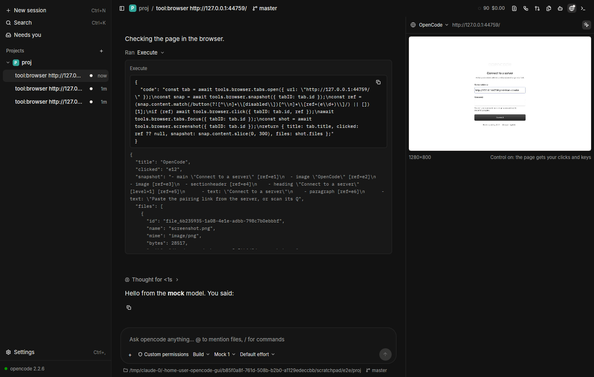

# Browser (spike)

_Branch `claude/browser-attach-spike`, 2026-11-08. Status: works end to end
against opencode 2.2.6; a spike, not finished._

ocdesk acts as opencode's **desktop browser**. opencode 2.2.6's
`@opencode/plugin-browser` gives the agent browser tools (`tools.browser.*`
in code mode) and a `browser` skill, but only while a desktop is attached to
the session; the desktop owns the browser and runs the operations. This is
what opencode's own Electron app does; ocdesk does it with a headless
Chromium and shows the agent's tab in a panel.

## How it works

- `src/browser/mod.rs` (`Host`): one attachment per opencode session
  (`POST /api/rpc/experimental.browser/attach`, held open);
  `rpc.experimental.browser.control` events from the event pump
  (`Event::BrowserControl`) announce `attached`, `command`, `cancel`;
  commands are fetched (`command`), run, and answered (`result`); the tab
  inventory goes out with `state` (before `tabs.open`/`close` results).
- `src/browser/chrome.rs`: a system Chrome / Chromium / Edge / Brave
  (`OCDESK_CHROME` overrides), launched on the first tab, headless, own
  profile in ocdesk's cache dir, `--remote-debugging-pipe` (no port: no
  other process can drive it). Exits with ocdesk.
- `src/browser/cdp.rs`: CDP over the pipe (NUL-framed JSON, flattened
  target sessions), ~150 lines.
- `src/browser/snapshot.rs`: `Accessibility.getFullAXTree` → the indented
  `- role "name" [state] [ref=eN]` text, refs → backend DOM node ids.
- One browser context per opencode session, one CDP target per tab.
- `src/ui/browser.rs`: Browser panel (`Mod+Shift+B`): the selected
  session's focused tab via `Page.startScreencast` (only while the tab
  shows), a tab picker, and Take control (clicks, wheel, typing → `Input.*`).

**Operations implemented:** `tabs.list/open/focus/close`, `navigate`,
`back`, `forward`, `reload`, `snapshot`, `click`, `hover`, `fill`, `press`,
`scroll`, `wait`, `screenshot`, `console`. Everything else answers
`unsupported` (the plugin's contract allows it).

**When ocdesk attaches:** the selected session (on select and after a
reconnect), and a new session before its first prompt (waits up to 2 s for
`attached`). Attachments stay until the server drops them.

## Verified

`cargo test` (133, including a CDP pipe test with a fake browser, snapshot
rendering, keys, console entries), clippy `-D warnings`. Under Xvfb with the
real opencode 2.2.6 sidecar, the mock model (`tool:browser`) and Playwright's
Chromium (`OCDESK_CHROME`): the agent's `tabs.open → snapshot → click →
tabs.focus → screenshot` ran through ocdesk; the result carried the snapshot
text and the screenshot; the panel streamed the tab; Take control typed into
the page.

## Found along the way

- **First turn race.** Attaching on selection was too late for a new
  session: the first tool call ran before the attachment and got
  "Unknown tool 'browser.tabs.open'" (opencode then injected "The Code Mode
  tool catalog has changed…" mid-turn). Fixed by attaching before the first
  prompt.
- **"Custom permissions".** Attaching makes the plugin add allow-rules for
  the browser tools to the session's permissions, so ocdesk's permission-mode
  pill shows "Custom permissions". Open: ignore the plugin's rules when
  classifying the mode, and make sure changing the mode doesn't drop them
  (which would hide the tools until the next attach).
- The URL policy is server-side: HTTP(S) and `about:blank` only.

## Not done

- Tab ownership (agent tab vs. user in control), as T3 Code does.
- Shortcut keys in Take control (Ctrl/Cmd chords aren't forwarded).
- `evaluate`, `frames`, `dialog`, `network.*`, `files.*`, `fill_form`,
  `find`, `select`, `check`, `drag`, `preview`; the `tunnel.*` methods
  (only needed for remote servers).
- Attachment policy beyond "selected + new" (running sessions, idle detach).
- macOS run (pipe fds and Chrome paths are written for it, untested).
