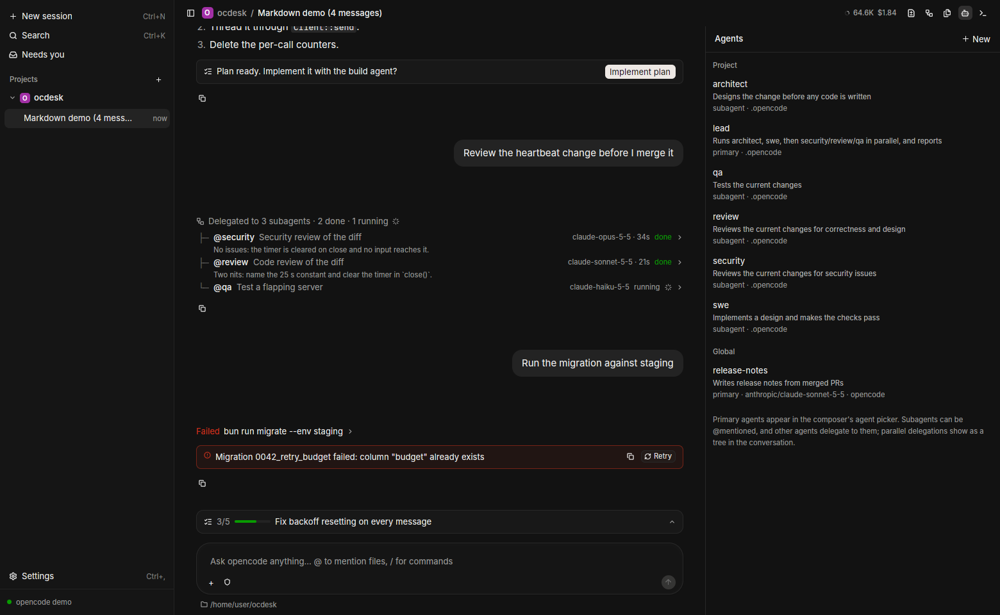

# Attachments, permissions, settings, review and usage

Built on master `9a2b04f` (the M0–M7 implementation). This batch implements
requested items 4–8 and 10. Item 9 (commit, push, PR creation) is intentionally
excluded; existing branch/worktree controls are preserved.

## Attachments

Use the `+` button, drop regular files into the composer, or paste copied files
and images. Remove an attachment by clicking its chip. The prompt may contain
up to **100 files total**, including `@` file mentions. The composer and HTTP
client enforce this limit (opencode 2.2.6 itself does not enforce 100).
Attachment-only prompts work. Commands with attachments are sent as ordinary
prompts rather than silently discarding the attachments.

Pastes above 16,000 characters or 200 lines become a UTF-8 text attachment.
Clipboard images retain their encoded format. Pasted data is saved off the UI
thread under the platform data directory's `ocdesk/attachments/<random>/`.
On Unix these directories/files use modes 0700/0600. Files intentionally remain
available for queued prompts and later replay; no automatic cache eviction is
implemented. Remove this cache manually only after pending prompts have finished.

Draft attachments stay with their thread (and with the project for unsent new
threads). A paste finishing after a thread switch attaches to its original draft.
An in-progress paste blocks Send. Directories and missing files are rejected;
missing queued attachment paths prevent taking that queued prompt back for editing.
The transcript and pending queue show attachment names. The client retains
metadata, not base64 file bodies, in its conversation store.

## Permission modes

The composer changes the selected session's rules using `PATCH /api/session/id`.
A new thread inherits OpenCode's configured permissions. An explicit composer
choice applies to that draft **before its first prompt**, then resets for the
next new thread. Global and project defaults live in `opencode.json(c)`.
A server read confirms the displayed mode; unrelated rules display as Custom.

| Mode | Session rules |
| --- | --- |
| Supervised | Ask for actions; allow read/glob/grep |
| Auto-accept edits | Supervised plus allow edit |
| Full access | Allow actions, subject to opencode's other restrictions |

**Probed on 2.2.6:** permissions are ordered arrays of
`{action, resource, effect}`, not v1 configuration maps. Saved project grants
precede the session's ask rules. Therefore Supervised can still allow actions
that have an existing saved grant. Settings lists
saved grants with explicit **Revoke** controls. Revoking affects every thread
in that project. Changing mode does not answer an already-pending approval or
cancel an executing tool.

## Sending and stopping

Sending a prompt shows **Sending…** immediately, including while a new session
is being created. A spinner beside **Thinking…** or **Working…** stays below the
latest message while OpenCode runs, and yields to approval/question cards.
The composer offers a circular **Stop** button with a solid square on a muted
background. **Stopping…** appears in the activity indicator and tooltip; duplicate
interrupts are prevented until the turn stops or the request fails.

## Notifications and unread

Background completion, failure, approval requests and forms mark their root
thread unread; subagent events route to the parent thread. A selected thread is
read only while the window is active. Activation/selection clears its unread
mark and retracts its notification where the OS supports it. State persists
across restarts. Removed threads have their unread mark removed.

GPUI's native notification API provides delivery and click-through to the
thread. Notifications default on and can be disabled independently of unread
indicators in Settings. macOS uses notification authorization; Linux requires a
session notification service. The window title shows the unread count, and
macOS also displays a Dock badge. Notification bodies contain only the thread
title, not prompts or tool output. Native macOS delivery/Dock behavior still
needs testing on a Mac; Linux headless testing cannot verify OS delivery.

## Settings

Open **Settings** in the sidebar or press Cmd/Ctrl+comma. General and keybinding
changes are staged until **Save app settings**. Configuration files and saved
approval revocations have their own explicit save/revoke actions.

- Dark, light or system theme; theme changes apply immediately on save.
- **Updates**: the running version and the last check's result, **Check now**,
  and a switch for the automatic check (see the README's Updates section).
- **OpenCode**: global/project JSONC editor for real `opencode.json` and
  `opencode.jsonc` files, including `.opencode/` files. Existing formats are
  listed separately; parent configuration is available read-only. New files are
  created only with **Create configuration**. Comments, line endings and
  formatting are retained. Syntax errors and external-write conflicts preserve
  the draft. Save or discard before changing files or closing Settings.
- **Reload OpenCode** applies configuration through `/api/location/reload` when
  sessions are idle and no approvals/forms are pending. JSONC syntax is checked
  before saving; OpenCode checks its configuration fields on reload. The selected
  file can also be opened in the configured external editor.
- Editor executable, default `code`; arguments are not parsed as shell commands.
- **MCP servers**: choose a project to list its configured servers (including
  global config), active count, connection/authentication errors, and explicit
  Connect/Disconnect controls. Refresh reads the real OpenCode status. Setup
  instructions include local and remote examples under v2 `mcp.servers`, links
  directly to global/project configuration, and the official authentication guide.
- Notification toggle and saved-project-grant management across all added
  projects. Saved approvals refresh after **Always allow** and reconnecting;
  each project is queried explicitly, independently of the server's startup folder.
- App keybindings, with validation, duplicate rejection, and empty values to
  unbind. Saving rebuilds app bindings while preserving component/input bindings.
  Focused inputs keep their editing shortcuts when they conflict with app keys.

Existing settings files remain readable. Saves retain live window geometry,
unread state and viewed-file marks even if those changed while Settings was open.
Legacy ocdesk model/agent/permission defaults are ignored and no longer saved.
New threads inherit OpenCode's defaults; composer choices are session/draft
overrides and do not change the defaults for later threads.
`OCDESK_THEME` remains a startup theme override; a subsequent Settings save can
change the theme during the current run.

## Full diff review

Changes shows the working tree only: HEAD → working copy, untracked files
included (`/api/vcs/diff?mode=working`). Errors remain visible with Refresh
available; old requests cannot replace newer results.

The server supplies VCS diffs. Individual-commit review uses read-only Git log
and show commands; merge commits show the first-parent comparison, root commits
are supported, and filenames are passed after `--`. No Git write actions were
added. The most recent 50 commits are listed.

Viewed marks persist by project/scope/base/file and the returned patch's
fingerprint: a different patch clears its mark. This tracks the returned patch,
not an independent content hash for binary or server-truncated files. Open in
editor resolves paths within the project and starts the configured executable
without a shell. Deleted/missing/outside-project paths report an error.
Patch previews retain the 500-line / 2,000-character-per-line display limit;
Copy patch includes the entire returned patch. Server truncation is labeled.

## Pull request

Shown only when the `gh` CLI is installed (it uses gh's login and hosts). The
right panel's **Pull request** tab (`Mod+Shift+G`) and a header chip next to
the branch (`#15` with a red/amber/green dot) show the current checkout's PR:
state and review decision, checks (failed first, with durations), and
unresolved review threads plus conversation comments.

- A failed check expands to its failed-step log tail (`gh run view --job …
  --log-failed`, last 80 lines), or GitHub's annotations when the job never
  produced a log. **Send to agent** (per check, or all failures) prompts the
  current session with the check, commit and excerpt.
- Review threads and comments have checkboxes; **Send N comments to agent**
  builds one prompt with `path:line`, the end of the diff hunk and each reply.
- The PR is re-fetched every 20 s while checks run on an open PR, every 2 min
  otherwise, only while the window is active. Read-only: nothing is resolved,
  re-run or posted.

## Usage and context

The composer meter shows session tokens/cost, and a context estimate/bar when
available. Click it for input/output/reasoning, cache read/write, per-model
conversation usage and provider limits. Details update live and can be refreshed.

`session.usage.updated` replaces cumulative totals rather than adding them.
Session totals may include title-generation overhead; model rows aggregate
assistant messages only. Cache tokens are counted once, reasoning is reported
as a subset of output. Context is the latest assistant request's input plus
cache read/write from `/context`, compared with that model's context limit.
It is labeled an estimate, not an exact count of the next request. An implicit
server-default model is resolved from the context when absent from session info.
Provider limits from the experimental endpoint may be unavailable; that is
shown explicitly, including endpoint errors, rather than rendered as zero.

## Agents and subagents

Multi-agent pipelines (architect → swe → parallel security/review/qa →
report) are plain opencode agents: a primary **lead** agent whose prompt
delegates to subagents. ocdesk adds no workflow engine; it edits the agent
files and shows the delegation.

**Agents panel** (`Mod+Shift+A`, right panel). Lists the agent files
opencode 2.2.6 loads for the session's folder: `<root>/{agent,agents}/**/*.md`
for the roots `.opencode`, `.claude` and `.agents` in the folder, and
`$XDG_CONFIG_HOME/opencode` (default `~/.config/opencode` on every
platform), `~/.claude` and `~/.agents` globally. (Checked against the
2.2.6 sources: `core/src/config/plugin/agent.ts`, `config/discovery.ts`.)
Built-in agents from `GET /api/agent` are listed read-only.

- The editor changes `description`, `mode` (`primary` / `subagent` / `all`;
  missing means `all`), `model` (`provider/model#variant`, chosen from the
  folder's models) and the body, which opencode uses as the system prompt.
  Every other frontmatter entry (permissions, request, color, steps,
  comments) is kept verbatim; a legacy separate `variant` key is dropped
  when the model is set, since the variant now lives in the model string.
- Saving writes a temp file and renames it, refuses to overwrite a file that
  changed on disk since it was opened, and then re-reads the folder's agents
  so the composer's pickers update without waiting for opencode's
  `agent.updated`.
- **New → Project/Global agent** creates `<root>/agent/<name>.md` (or
  `agents/` if only that exists), never overwriting. **New → Team template**
  writes `lead` (primary) plus `architect`, `swe`, `security`, `review`, `qa`
  (subagents) into `.opencode/agent/`, skipping names that already exist.
  Pick `lead` in the composer to run the team.
- Delegation is the model's call: the template's lead prompt says to always
  use its subagents and to start the three reviewers together, but opencode
  doesn't enforce an order.

**Fan-out tree.** Two or more consecutive `subagent` calls in one reply are
drawn as one tree: "Delegated to 3 subagents · 2 done · 1 running", then a
branch per call with `@agent`, its task, the child session's model and run
time, its status and the first line of its result (or error). A branch opens
the subagent in the Tasks panel. A single delegation keeps the one-line task
row. Demo mode seeds a fan-out turn.



## Verification

Run the existing Rust checks plus:

```sh
python3 dev/desktop-features-test.py /path/to/opencode2
```

This uses a temporary Git repository, isolated settings/data, a real 2.2.6
sidecar and deterministic mock model. It tests encoded file URIs, attachment-only
prompts, PNG image transport, 100 files, mode changes, saved-grant precedence and
revocation, working/whole-branch/committed comparisons and usage/context/limits.
No provider credentials are required. CI runs this alongside existing tests.
